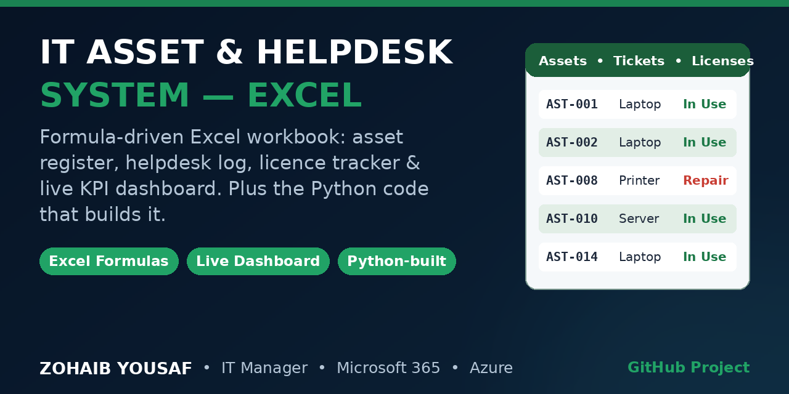

# IT Asset & Helpdesk Management System (Excel)



A formula-driven Excel workbook for day-to-day IT operations — built and maintained by **Zohaib Yousaf, IT Manager**. No macros, no add-ins: everything recalculates with standard Excel formulas, so it works in Microsoft Excel and Microsoft 365 on any tenant.


## What's inside

| Sheet | Purpose |
|---|---|
| **Dashboard** | Live KPIs (total assets, open tickets, device compliance %, average resolution time, licences available, monthly licence cost) + charts for tickets and assets by status |
| **Assets** | Hardware inventory — device, serial, assignee, department, purchase / warranty dates, Intune compliance. Warranty column auto-flags expiring (amber, ≤90 days) and expired (red) |
| **Helpdesk_Tickets** | Ticket log with category, priority (Critical/High highlighting), status dropdowns, resolution hours and a 48h SLA breach flag |
| **Licenses** | Software licence tracking — owned vs assigned, available licences, utilisation %, renewal dates, monthly cost — with automatic "FULL / Low / OK" status |
| **Onboarding_Checklist** | New-starter IT checklist: M365 account, groups, Intune enrolment, MFA / Conditional Access, device handover |
| **Summary** | Formula counts that feed the Dashboard charts |

## Key features

- **100% formula-driven** — `COUNTIF / COUNTIFS / SUM / AVERAGE` KPIs, no hard-coded totals
- **Data validation dropdowns** for Status, Priority and Compliance — no free-text drift
- **Conditional formatting** for warranty risk, SLA breaches and priority levels
- **Excel Tables** with filters and frozen panes on every register
- **Reproducible build** — the workbook is generated by [`build_workbook.py`](build_workbook.py) (Python + openpyxl), so the whole system can be rebuilt or extended from code

## Run it

**Use the workbook:** open `IT_Asset_Helpdesk_Management_System.xlsx` in Excel / Microsoft 365 and start editing the registers — the Dashboard updates itself.

**Rebuild from code:**

```bash
pip install openpyxl
python build_workbook.py
```

## Sample data

The workbook ships with realistic sample data (20 assets, 15 tickets, 6 licence lines) so every formula and chart works on first open. Replace it with your own inventory — keep the dropdown values as they are.

## Author

**Zohaib Yousaf** — IT Manager / Digital Operations, Islamabad, Pakistan
6+ years in IT operations: SCCM / Intune, Microsoft 365, Azure, LAN/WAN.

- 🌐 [zohaibyousaf.com](https://zohaibyousaf.com)
- 💼 [linkedin.com/in/zohaibyousaf](https://linkedin.com/in/zohaibyousaf)
- 📧 info@zohaibyousaf.com

## License

MIT — see [LICENSE](LICENSE).
